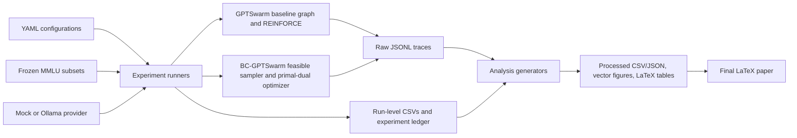

# BC-GPTSwarm

Submission deliverables:

- [Five-page IEEE manuscript](paper/main_short.pdf) and [LaTeX source](paper/main_short.tex).
- [Self-contained Overleaf upload ZIP](outputs/BC-GPTSwarm-overleaf.zip); select `main.tex` and pdfLaTeX after import.
- [10-slide presentation](outputs/BC-GPTSwarm-research-presentation.pptx): slides 1–3 cover existing work and the problem; slides 4–10 cover the proposed extension.
- [Matching 10-minute speaker script](outputs/BC-GPTSwarm-10-minute-script.md).
- [Submission build instructions and scope](paper/README.md).

BC-GPTSwarm is a reproducible, reduced GPTSwarm study that asks whether a stochastic language-agent graph can optimize task utility while satisfying an explicit expected-token budget. The repository contains the implementation, frozen data, complete raw traces, experiment ledger, generated analyses, and final paper.

The study is complete. Its main result is negative but informative: middle-budget BC-GPTSwarm used 5.8% fewer tokens than the original accuracy-only baseline, but did not improve mean accuracy and remained 4.0% over its expected budget. Tight-budget convergence was not established under the fixed 12-iteration allowance.

- Final paper: [`paper/main.pdf`](paper/main.pdf)
- Statistical analysis: [`docs/phase9_statistical_analysis.md`](docs/phase9_statistical_analysis.md)
- Final manuscript audit: [`docs/phase10_paper_audit.md`](docs/phase10_paper_audit.md)
- Reproduction-package audit: [`docs/phase11_reproducibility_audit.md`](docs/phase11_reproducibility_audit.md)

## Project overview

[GPTSwarm](https://proceedings.mlr.press/v235/zhuge24a.html) represents language-agent systems as optimizable computational graphs. This project reproduces its adversarial-MMLU edge optimizer in a small local-model setting and adds a primal--dual constraint:

```text
maximize_theta    E[utility(G)]
subject to        E[tokens(G)] <= B
```

BC-GPTSwarm adds four pieces to the reduced baseline:

1. sampling conditioned on executable graph feasibility;
2. the corresponding conditional policy-gradient correction;
3. per-execution token and resource telemetry; and
4. a projected non-negative Lagrange multiplier learned from normalized budget violation.

This is deliberately not a full reproduction of every GPTSwarm task or its original hosted models. It is a controlled behavioral reproduction using the same model, prompts, data, and execution rules across comparators.

## Result snapshot

The focal comparison uses three optimizer seeds and 24 held-out MMLU questions per seed.

| Condition | Accuracy | Tokens/question | Normalized budget violation |
|---|---:|---:|---:|
| Original accuracy-only GPTSwarm | 0.250 | 251.1 | not a constrained method |
| BC-GPTSwarm, middle budget | 0.236 | 236.7 | +4.0% |

The paired accuracy effect is -1.39 percentage points with a 95% interval of [-13.34, +10.56]. The paired token effect is -14.4 tokens/question with a 95% interval of [-236.7, +207.8]. All inferential claims are limited by three independent seed pairs; see the paper and statistical analysis for assumptions and exact tests.

## Provenance

The baseline compatibility layer follows GPTSwarm commit `1e1e5899d51bde690672417cf92aa4de7b210422`. The exact mapping to publication-era source files and the upstream MIT license are recorded in [`vendor/gptswarm_reference/SOURCE_MANIFEST.md`](vendor/gptswarm_reference/SOURCE_MANIFEST.md).

The local code is a minimal compatibility layer, not a claim of independent invention of GPTSwarm's graph representation, prompts, majority-vote operation, or accuracy-only edge optimizer.

## Architecture



The baseline and proposed method share graph construction, model calls, prompts, data, and evaluation. The proposed path changes sampling and the optimization objective; it does not change the underlying model.

## Reproduction levels

There are three useful levels of reproduction:

1. **Package verification, no model calls:** validate frozen data, committed result matrices, raw traces, the ledger, and generated artifacts.
2. **Credential-free software reproduction:** run the deterministic mock-provider tests and smoke configurations.
3. **Full behavioral reproduction:** install Ollama and rerun the baseline, controlled comparison, and ablations with `qwen2.5:0.5b`.

The full experiment commands overwrite their corresponding CSV/JSONL outputs and append entries to the experiment ledger. Use a clean branch or disposable clone when comparing a rerun with the committed snapshot.

## System requirements

The recorded environment is:

- Python 3.10.9; the package requires Python `>=3.10,<3.11`;
- the exact Python packages in [`requirements.txt`](requirements.txt);
- CPU-only PyTorch 2.8.0;
- Ollama 0.17.1 with `qwen2.5:0.5b` for real-model runs;
- an Intel CPU with 16 logical cores and approximately 16.9 GB RAM for the reported run;
- a LaTeX distribution with `pdflatex`, BibTeX, and `IEEEtran.bst` to rebuild the paper; and
- Poppler's `pdftoppm` only for optional page-image inspection.

The measured baseline, main comparison, and ablation workload consumed about 1.5 hours of recorded inference-plus-optimization time on the reference machine. Wall time varies with Ollama warm-up, CPU scheduling, and local load; one retained optimization outlier was substantially slower.

### Environment variables

No environment variables, API keys, or hosted credentials are required. Provider endpoints and model settings are explicit in the YAML files. The real-model configurations expect Ollama at `http://127.0.0.1:11434`; edit `model.base_url` in the relevant configuration if your server is elsewhere.

## Installation

From the repository root, create a Python 3.10 virtual environment and install the exact pins.

Windows PowerShell:

```powershell
py -3.10 -m venv .venv
.venv\Scripts\Activate.ps1
python -m pip install --upgrade pip
python -m pip install -r requirements.txt
```

POSIX shells:

```bash
python3.10 -m venv .venv
source .venv/bin/activate
python -m pip install --upgrade pip
python -m pip install -r requirements.txt
```

An editable package install is optional:

```bash
python -m pip install -e .
```

The scripts also add `src/` to their import path, so the editable install is not required for the documented commands.

## Dataset preparation

The exact 24-example development and 24-example validation subsets are committed in [`data/mmlu`](data/mmlu). They were selected from `cais/mmlu`, configuration `all`, at immutable revision `c30699e8356da336a370243923dbaf21066bb9fe`, using selection seed 888.

Verify the committed files without network access:

```bash
python scripts/verify_reproducibility.py
```

The verifier checks the SHA-256 digests and example IDs against [`data/mmlu/manifest.json`](data/mmlu/manifest.json). To regenerate the subsets from Hugging Face instead, run:

```bash
python scripts/prepare_mmlu.py --dev-count 24 --validation-count 24 --seed 888
```

Regeneration requires network access and rewrites the manifest's retrieval timestamp. With the pinned dataset revision, seed, and selection code, the two JSONL content hashes should match the committed manifest.

## Credential-free verification

Run the full offline test suite and package integrity checker:

```bash
python -m pytest -q
python scripts/verify_reproducibility.py
```

The committed package should report 14 passing tests, 42 complete core research runs, 51 ledger entries, valid dataset hashes, complete raw traces, and all required generated artifacts.

Run the deterministic baseline and constrained-optimizer smoke tiers if desired:

```bash
python scripts/run_baseline.py --config configs/smoke.yaml
python scripts/run_proposed.py --config configs/proposed_smoke.yaml
```

Mock results validate software behavior only and are not research evidence.

## Ollama setup

Install Ollama separately, start its local server, and obtain the recorded model:

```bash
ollama pull qwen2.5:0.5b
ollama list
```

Then run the five-example real-model smoke tier:

```bash
python scripts/run_baseline.py --config configs/ollama_smoke.yaml
```

Do not start the full matrix until this succeeds. The experiment configurations disable response caching because latency is measured.

## Baseline reproduction

Run the 12-run direct/full/random/optimized matrix:

```bash
python scripts/run_baseline.py --config configs/baseline.yaml
python scripts/generate_baseline_artifacts.py
```

This writes [`results/baseline_results.csv`](results/baseline_results.csv), per-run JSONL traces under `results/raw/`, the baseline summary, figure, LaTeX table, and ledger rows.

## Proposed-method execution and main experiments

The credential-free proposed-method command above is only a software sanity check. The real BC-GPTSwarm comparisons are conditions in the controlled runner:

```bash
python scripts/run_comparison.py --config configs/main_experiments.yaml
```

This executes, for seeds 11, 22, and 33:

- the publication-style accuracy-only baseline;
- a feasibility-matched accuracy-only control;
- a fixed-penalty control; and
- BC-GPTSwarm at budget ratios 0.50, 0.75, and 1.00.

The configuration fixes the reference full-graph cost at the observed baseline value of `303.2916666667` tokens/question. Leave this value unchanged for exact reproduction. If you intentionally construct a new study from a materially different baseline run, update `resource.reference_tokens_per_example` in both controlled configuration files before running either matrix and document that deviation.

## Ablations

Run the 12 additional ablation conditions:

```bash
python scripts/run_comparison.py --config configs/ablations.yaml
```

These isolate utility centering, dual learning rates 0.05 and 0.50, and a larger 2-truthful/2-adversarial-agent graph. The result generator combines these runs with the main conditions to form [`results/ablation_results.csv`](results/ablation_results.csv).

## Regenerate results, tables, and figures

All paper tables and figures derive from committed CSV/JSONL data rather than manually transcribed values:

```bash
python scripts/generate_baseline_artifacts.py
python scripts/generate_study_artifacts.py
python scripts/generate_statistical_analysis.py
```

Outputs include:

- aggregate CSV and JSON files in `results/processed/`;
- vector PDF figures in `results/figures/`;
- generated LaTeX tables in `paper/tables/`; and
- the statistical-analysis narrative in `docs/phase9_statistical_analysis.md`.

Historical committed result rows contain Windows-style raw-trace separators. The analysis and verification scripts normalize both Windows and POSIX paths, while new runs write portable forward-slash paths.

## Compile the paper

From a clean checkout:

```bash
cd paper
pdflatex -interaction=nonstopmode -halt-on-error main.tex
bibtex main
pdflatex -interaction=nonstopmode -halt-on-error main.tex
pdflatex -interaction=nonstopmode -halt-on-error main.tex
```

The expected output is a 12-page [`paper/main.pdf`](paper/main.pdf). The repository uses a clean two-column `article` fallback because `IEEEtran.cls` was unavailable in the recorded build environment; `IEEEtran.bst` is used for references.

## Configuration map

| File | Purpose | Provider | Scale |
|---|---|---|---|
| `configs/smoke.yaml` | baseline software smoke | deterministic mock | 4 runs, 5 examples |
| `configs/proposed_smoke.yaml` | constrained optimizer smoke | deterministic mock | 1 run, 5 examples |
| `configs/ollama_smoke.yaml` | provider integration smoke | Ollama | 4 runs, 5 examples |
| `configs/baseline.yaml` | reduced GPTSwarm baseline | Ollama | 12 runs, 24 examples |
| `configs/main_experiments.yaml` | controlled main comparison | Ollama | 18 runs, 24 examples |
| `configs/ablations.yaml` | additional ablations | Ollama | 12 runs, 24 examples |

Every major run records its configuration hash, dataset hashes, prompts, model settings, package/runtime information, graph state, predictions, token counts, latency, failures, and, where applicable, optimizer trajectory in the raw trace and ledger.

## Repository structure

```text
.
|-- configs/                    versioned experiment configurations
|-- data/mmlu/                  frozen subsets and checksum manifest
|-- docs/                       design, analysis, and audit documents
|-- experiments/                append-only experiment ledger
|-- paper/                      live LaTeX source, generated tables, final PDF
|-- results/
|   |-- raw/                    per-run manifests, trajectories, and evaluations
|   |-- processed/              generated summaries and statistical outputs
|   `-- figures/                generated vector figures
|-- scripts/                    experiment, analysis, and verification entry points
|-- src/gptswarm_ext/           baseline and BC-GPTSwarm implementation
|-- tests/                      credential-free unit tests
`-- vendor/gptswarm_reference/  upstream provenance and license
```

## Research-integrity and interpretation notes

- All declared seeds are retained; no run was removed based on outcome.
- Failed or disconnected random graphs remain logged and count as incorrect.
- The mock provider is never mixed with the real-model research comparison.
- The 0.5B local model is not numerically comparable to GPTSwarm's original hosted-model experiments.
- The token constraint is an expectation, not a per-query hard cap.
- API cost is zero because inference is local; token counts are the primary resource measure.
- Latency is hardware- and scheduling-dependent and should not be compared across machines as though it were a controlled model property.
- With only three independent seed pairs, confidence intervals are broad and exact tests have coarse resolution.

See [`docs/deviation_log.md`](docs/deviation_log.md) for all departures from the original GPTSwarm setup and [`docs/phase6_8_protocol.md`](docs/phase6_8_protocol.md) for the locked controlled protocol.
